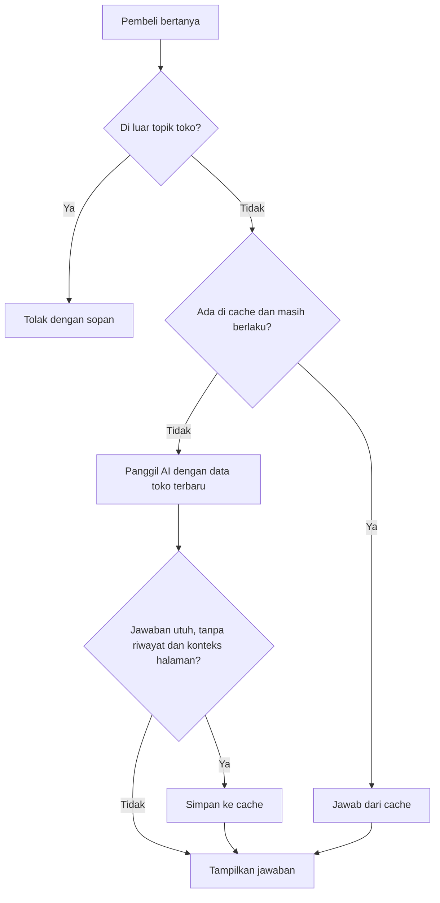
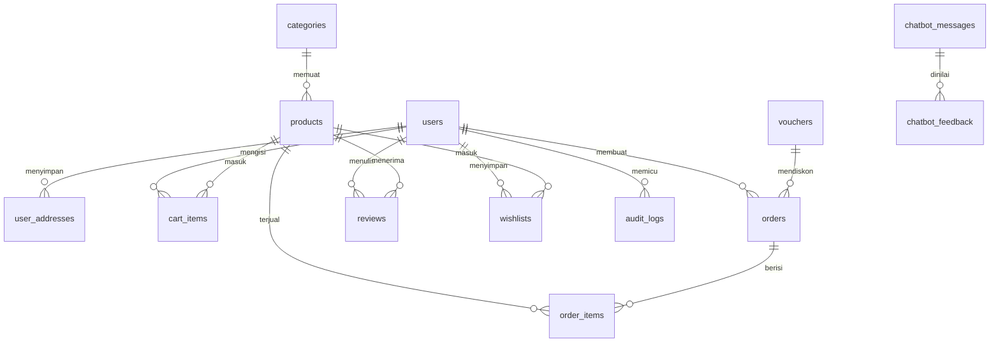

<div align="center">

# VinzyPlay

**Toko online untuk gaming gear, komponen PC, diecast koleksi, dan hobi, lengkap dengan asisten belanja AI.**


[Fitur](#fitur) · [Chatbot AI](#chatbot-ai) · [Arsitektur](#arsitektur) · [Instalasi](#instalasi) · [Pengujian](#pengujian)

</div>

---

## Tentang Proyek

VinzyPlay mencakup alur belanja dari katalog sampai pelacakan paket, ditambah panel admin dan chatbot yang menjawab dari data toko. Pembayaran dan pengiriman berjalan dalam mode simulasi, termasuk kode QR QRIS yang hanya contoh, jadi kamu bisa mencoba seluruh alur tanpa uang asli.

Proyek ini dibuat oleh **Rafi Pandya P** untuk mata kuliah Praktik MSI.

## Fitur

### Belanja

| Area | Yang bisa dilakukan pembeli |
|---|---|
| **Katalog** | Mencari produk, memfilter kategori, melihat banner promo, flash sale dengan hitung mundur, dan halaman promo |
| **Voucher** | Menyalin kode dari halaman promo, lalu memakainya di keranjang atau checkout |
| **Produk** | Melihat detail, simulasi cicilan, ulasan pembeli, dan menyimpan ke wishlist |
| **Keranjang** | Memilih barang yang mau dibeli, mengubah jumlah, dan melihat total langsung berubah |
| **Checkout** | Memilih alamat tersimpan, Pengiriman Reguler atau Kilat, lalu Transfer Bank (Virtual Account), QRIS, atau COD |
| **Pesanan** | Mengikuti status pesanan, nomor resi, dan timeline perjalanan paket |
| **Invoice** | Mencetak invoice pesanan atau menyimpannya sebagai PDF lewat browser |
| **Ulasan** | Mengulas produk setelah pesanan selesai |
| **Akun** | Mengelola profil, buku alamat, password, dan riwayat pesanan |

Ongkir Reguler Rp15.000 dan gratis untuk belanja minimal Rp300.000 setelah diskon. Ongkir Kilat Rp25.000.

### Panel Admin

- Dashboard dengan grafik pendapatan bulanan dan ringkasan toko
- Pengelolaan kategori, produk, voucher, pengguna, dan pesanan
- Dashboard chatbot: cache, hit rate, penilaian pengguna, dan estimasi penghematan energi

### Keamanan

- Rate limit: login dan registrasi 5 kali per menit, chatbot 20 kali per menit
- Password wajib minimal 8 karakter, dan saat registrasi harus memuat huruf dan angka
- Audit log untuk perubahan peran pengguna, perubahan status pesanan, dan penghapusan cache chatbot
- Cookie sesi `Secure` otomatis aktif di production

## Chatbot AI

Pembeli bisa bertanya soal harga, stok, rekomendasi produk, voucher, ongkir, dan metode pembayaran. Chatbot terhubung ke API apa pun yang kompatibel dengan format OpenAI.

- **Jawaban dari data toko:** setiap panggilan AI membawa katalog, voucher aktif, dan aturan ongkir terbaru.
- **Paham konteks:** chatbot membaca 8 pesan terakhir dan mengenali produk di halaman yang sedang dibuka.
- **Streaming:** teks jawaban muncul bertahap.
- **Kartu produk:** produk yang disebut AI tampil dengan harga terkini dan tombol tambah ke keranjang.
- **Batas topik:** filter server menolak hitungan dan tugas sekolah sebelum memanggil AI, sehingga token tidak terbuang.
- **Penilaian:** pembeli memberi 👍 atau 👎, dan admin membaca hasilnya di dashboard.

### Green Computing

Cache menghemat panggilan AI untuk pertanyaan yang sama, termasuk beda penulisan seperti "Berapa harga PS5?" dan "harga playstation 5 dong kak". Admin melihat estimasi token, listrik, dan emisi yang dihemat.

Tiga aturan menjaga cache tetap akurat:

1. Sistem hanya menyimpan jawaban utuh yang dibuat tanpa riwayat chat dan tanpa konteks halaman. Riwayat datang dari browser dan bisa dipalsukan.
2. Perubahan produk, kategori, atau voucher membuat semua jawaban tersimpan kedaluwarsa.
3. Pertanyaan harus punya kata kunci yang sama persis, jadi "G304" tidak memakai jawaban "G502".



## Arsitektur

| Lapisan | Teknologi |
|---|---|
| Backend | PHP 8.2+, Laravel 12 |
| Frontend | Blade, Tailwind CSS 4, JavaScript |
| Build | Vite 7 |
| Database | PostgreSQL (Neon atau lokal) |
| AI | API chat completions kompatibel OpenAI |
| Pengujian | PHPUnit |

Aplikasi punya 13 tabel inti, di luar tabel bawaan Laravel:



Kode utama chatbot ada di `app/Services/ChatbotService.php`, dan perhitungan keranjang ada di `app/Support/CartCalculator.php`.

## Instalasi

Siapkan PHP 8.2+, Composer 2, Node.js, dan PostgreSQL. [Neon](https://neon.tech) bisa dipakai kalau tidak ingin memasang database lokal.

```bash
git clone https://github.com/vinzyid/ecommerce-msi.git
cd ecommerce-msi
composer install
npm install
cp .env.example .env
php artisan key:generate
```

Isi koneksi database di `.env`:

```dotenv
DB_CONNECTION=pgsql
DB_HOST=ep-xxxxx.ap-southeast-1.aws.neon.tech
DB_PORT=5432
DB_DATABASE=neondb
DB_USERNAME=username
DB_PASSWORD=password
DB_SSLMODE=require
```

> Kalau memakai Neon, gunakan host direct (tanpa `-pooler`). Host pooler bisa memicu error `SQLSTATE[25P02]` saat checkout.

Isi juga konfigurasi chatbot. Toko tetap berjalan tanpa API key, tapi chatbot tidak bisa menjawab.

```dotenv
CHATBOT_API_KEY=isi_api_key
CHATBOT_BASE_URL=https://api.openai.com/v1
CHATBOT_MODEL=gpt-4o-mini
```

Lalu buat tabel, isi data contoh, dan bangun aset:

```bash
php artisan migrate --seed
npm run build
php artisan serve
```

Buka http://127.0.0.1:8000. Saat mengubah tampilan, jalankan `npm run dev` di terminal lain untuk hot reload.

Nama toko mengikuti `APP_NAME` di `.env` dan otomatis tampil di judul, logo, footer, dan sapaan chatbot.

### Akun Contoh

| Peran | Email | Password |
|---|---|---|
| Admin | `haloadmin@vinzyplay.test` | `Admin123!` |
| Pembeli | `budi@example.com` | `Password123!` |

Panel admin ada di `/admin`. Ganti kedua password ini sebelum deploy ke server publik.

## Pengujian

```bash
php artisan test
```

Test memakai SQLite in-memory dan AI palsu, jadi database development dan kuota API kamu aman. Saat ini ada 105 test yang mencakup autentikasi, alur belanja, panel admin, dan chatbot.

Untuk membandingkan kualitas dan kecepatan model AI, jalankan `php artisan chatbot:benchmark`. Perintah ini memanggil API asli dan memakai kuota.

## Struktur Proyek

```text
app/
├── Console/Commands/     # chatbot:benchmark
├── Http/Controllers/     # Toko, akun, dan Admin/
├── Models/               # Eloquent dan Concerns/ExpiresChatbotCache
├── Services/             # ChatbotService
└── Support/              # CartCalculator
database/
├── migrations/
└── seeders/              # Akun, kategori, produk, ulasan, voucher
resources/
├── css/app.css           # Tema Tailwind
├── js/app.js             # Chatbot, carousel, toast, keranjang
└── views/                # Halaman toko, admin, dan widget chatbot
tests/Feature/            # Test autentikasi, belanja, admin, chatbot
```
